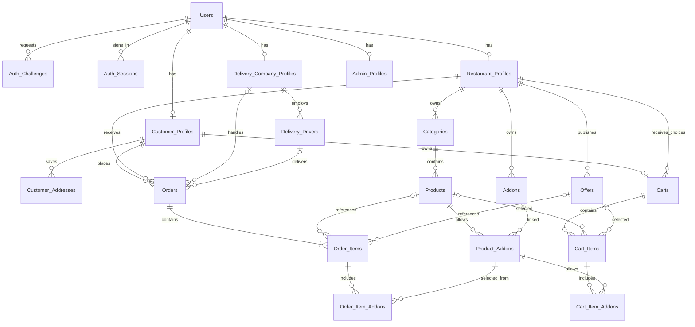
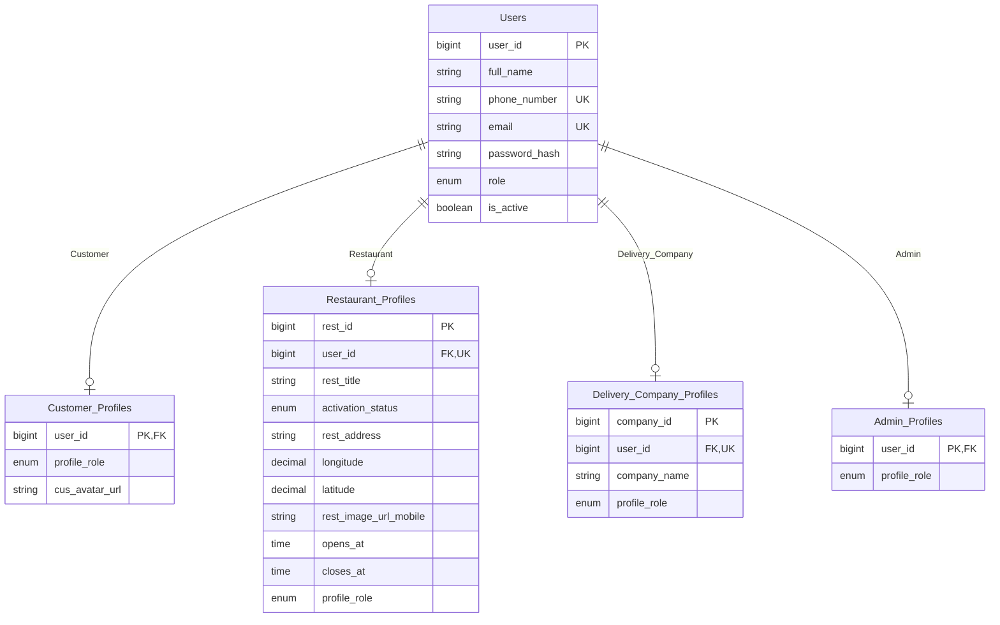

# Rico — Database Design

> `PK` = primary key, `FK` = foreign key, `UQ` = unique, `NN` = required, `NULL` = optional. All fields are required unless marked `NULL`. SQL syntax depends on the database engine and version.

## 1. Design Rules

- Each user has one role: `Customer`, `Restaurant`, `Delivery_Company`, or `Admin`.
- Each user has one matching profile. Create both in one transaction.
- `Restaurant_Profiles` and `Delivery_Company_Profiles` store restaurant and company data; no separate tables are needed for these entities.
- Each restaurant or company account manages one restaurant or company.
- Drivers belong to companies and have no login accounts in this version.
- Keep BIGINT identifiers as decimal strings in APIs and application data; do not cast them to JavaScript numbers.
- Use EGP as the app-wide currency and `DECIMAL(12,2)` for money. The initial general delivery fee is EGP 30.00; an Admin fee-management endpoint is planned for a later feature.
- Use `Picked_Up` for the pickup status.
- Each customer may keep one cart for one restaurant. Cart checkout creates a separate order with saved names and prices.

## 2. Main Relationships



- Each account has only its matching profile.
- Each order must have at least one item; enforce this in the app transaction.
- Each order item references one product or one offer.

## 3. Tables and Attributes

### 3.1 Users

```text
┌──────────────────────────────────────────────────┐
│ Users                                            │
├──────────────────────────────────────────────────┤
│ user_id             BIGINT          PK           │
│ full_name           VARCHAR(150)    NN           │
│ phone_number        VARCHAR(25)     NN, UQ       │
│ email               VARCHAR(254)    NN, UQ       │
│ password_hash       VARCHAR(255)    NN           │
│ role                ENUM            NN           │
│ is_active           BOOLEAN         DEFAULT TRUE │
│ email_verified_at   TIMESTAMP       NULL         │
│ created_at          TIMESTAMP       NN           │
│ updated_at          TIMESTAMP       NN           │
└──────────────────────────────────────────────────┘
```

- `role IN ('Customer', 'Restaurant', 'Delivery_Company', 'Admin')`.
- `UNIQUE (user_id, role)`.
- Store phone numbers in a standard international format. Normalize email values before checking uniqueness.
- Email is required and unique for all roles. Registration requires full name, email, password, and phone. Login uses email and password.
- Verify email only, using OTP; no phone OTP is required. Keep `email_verified_at` NULL until verified. Block login until the account is active and its email is verified.
- Store a secure password hash. This design uses password login.

### 3.2 Customer_Profiles

```text
┌────────────────────────────────────────────────────────┐
│ Customer_Profiles                                      │
├────────────────────────────────────────────────────────┤
│ user_id             BIGINT          PK, FK → Users     │
│ profile_role        ENUM            DEFAULT 'Customer' │
│ cus_avatar_url      TEXT            NULL               │
│ created_at          TIMESTAMP       NN                 │
│ updated_at          TIMESTAMP       NN                 │
└────────────────────────────────────────────────────────┘
```

- `CHECK (profile_role = 'Customer')`.
- `FK (user_id, profile_role) → Users (user_id, role)`.
- Keep shared name, phone, and email fields in `Users`.
- `cus_avatar_url` stores the customer's avatar image URL; it is optional.

### 3.3 Restaurant_Profiles

```text
┌──────────────────────────────────────────────────────────┐
│ Restaurant_Profiles                                      │
├──────────────────────────────────────────────────────────┤
│ rest_id             BIGINT          PK                   │
│ user_id             BIGINT          NN, UQ, FK → Users   │
│ profile_role        ENUM            DEFAULT 'Restaurant' │
│ rest_title          VARCHAR(150)    NN                   │
│ rest_description    TEXT            NULL                 │
│ rest_address        TEXT            NN                   │
│ longitude           DECIMAL(10,7)   NN                   │
│ latitude            DECIMAL(10,7)   NN                   │
│ rest_image_url_mobile TEXT            NULL               │
│ opens_at            TIME            NN                   │
│ closes_at           TIME            NN                   │
│ activation_status   ENUM            DEFAULT Pending      │
│ is_active           BOOLEAN         DEFAULT TRUE         │
│ created_at          TIMESTAMP       NN                   │
│ updated_at          TIMESTAMP       NN                   │
└──────────────────────────────────────────────────────────┘
```

- `CHECK (profile_role = 'Restaurant')`.
- `FK (user_id, profile_role) → Users (user_id, role)`.
- `Users.full_name` is the account owner's name; `rest_title` is the restaurant name.

- `rest_image_url_mobile` stores the image that represents the restaurant in the mobile app.
- `opens_at` and `closes_at` define one daily opening period in the restaurant's local time.
- `CHECK (opens_at <> closes_at)`. If `closes_at < opens_at`, closing is on the next day.
- Hint: These fields use the same hours every day; weekly hours, breaks, and 24-hour opening need a separate schedule.
- `rest_address` stores the restaurant pickup address.
- `longitude` and `latitude` store the restaurant pickup location.
- `CHECK (longitude >= -180 AND longitude <= 180)`.
- `CHECK (latitude >= -90 AND latitude <= 90)`.
- `activation_status IN ('Pending', 'Active', 'Suspended')`; it is required and defaults to Pending.
- Restaurant owners register publicly with account fields and restaurant profile details. Email OTP verification is separate from Admin activation.
- Only Admin may set Active or Suspended. Owners cannot submit or edit activation status. Suspended restaurants can be reactivated.
- Pending/Suspended owners with active, email-verified accounts may log in and read their account, profile, and dashboard status only; business APIs remain blocked.
- Check current activation status on every restaurant business request. Active status is also required for public menu visibility, cart additions/edits, quotes, and new orders.
- `Users.is_active` controls login, `activation_status` controls Admin approval, and restaurant `is_active` controls service activity. Owners cannot bypass Admin suspension by changing service activity.
- Suspension preserves existing orders and snapshots. Assigned companies can finish delivery; no automatic cancellation is performed.

### 3.4 Delivery_Company_Profiles

```text
┌────────────────────────────────────────────────────────┐
│ Delivery_Company_Profiles                              │
├────────────────────────────────────────────────────────┤
│ company_id          BIGINT          PK                 │
│ user_id             BIGINT          NN, UQ, FK → Users │
│ profile_role        ENUM            'Delivery_Company' │
│ company_name        VARCHAR(150)    NN                 │
│ company_phone       VARCHAR(25)     NN                 │
│ company_email       VARCHAR(254)    NULL               │
│ company_address     TEXT            NN                 │
│ is_active           BOOLEAN         DEFAULT TRUE       │
│ created_at          TIMESTAMP       NN                 │
│ updated_at          TIMESTAMP       NN                 │
└────────────────────────────────────────────────────────┘
```

- `DEFAULT 'Delivery_Company'` for `profile_role`.
- `CHECK (profile_role = 'Delivery_Company')`.
- `FK (user_id, profile_role) → Users (user_id, role)`.
- Company contact details may differ from the account owner's details.

### 3.5 Admin_Profiles

```text
┌─────────────────────────────────────────────────────┐
│ Admin_Profiles                                      │
├─────────────────────────────────────────────────────┤
│ user_id             BIGINT          PK, FK → Users  │
│ profile_role        ENUM            DEFAULT 'Admin' │
│ created_at          TIMESTAMP       NN              │
│ updated_at          TIMESTAMP       NN              │
└─────────────────────────────────────────────────────┘
```

- `CHECK (profile_role = 'Admin')`.
- `FK (user_id, profile_role) → Users (user_id, role)`.
- Hint: Fixed `profile_role` values and composite FKs enforce the matching user role. Use compatible column types; `VARCHAR` with `CHECK` may replace `ENUM`.

### 3.6 Customer_Addresses

```text
┌────────────────────────────────────────────────────────────┐
│ Customer_Addresses                                         │
├────────────────────────────────────────────────────────────┤
│ address_id          BIGINT          PK                     │
│ user_id             BIGINT          FK → Customer_Profiles │
│ address_title       VARCHAR(100)    NN                     │
│ address_line        TEXT            NN                     │
│ longitude           DECIMAL(10,7)   NN                     │
│ latitude            DECIMAL(10,7)   NN                     │
│ is_default          BOOLEAN         DEFAULT FALSE          │
│ created_at          TIMESTAMP       NN                     │
│ updated_at          TIMESTAMP       NN                     │
└────────────────────────────────────────────────────────────┘
```

- `user_id → Customer_Profiles.user_id`: only customers can own addresses.
- Each customer may save at most 2 addresses.
- `address_title` is a label such as Home; `address_line` stores the full address.
- `CHECK (-180 <= longitude AND longitude <= 180)`.
- `CHECK (-90 <= latitude AND latitude <= 90)`.
- Allow at most one default address per customer. Use a unique filtered index on `user_id WHERE is_default = TRUE`, or a nullable generated column with a unique index if needed.
- Do not use `UNIQUE (user_id, is_default)`; customers may have many non-default addresses.

### 3.7 Categories

```text
┌──────────────────────────────────────────────────────────────┐
│ Categories                                                   │
├──────────────────────────────────────────────────────────────┤
│ cat_id              BIGINT          PK                       │
│ rest_id             BIGINT          FK → Restaurant_Profiles │
│ cat_title           VARCHAR(150)    NN                       │
│ is_active           BOOLEAN         DEFAULT TRUE             │
│ display_order       INTEGER         DEFAULT 0                │
│ created_at          TIMESTAMP       NN                       │
│ updated_at          TIMESTAMP       NN                       │
└──────────────────────────────────────────────────────────────┘
```

- `UNIQUE (rest_id, cat_title)`: the same title is allowed in different restaurants.
- `UNIQUE (rest_id, cat_id)`.
- `CHECK (display_order >= 0)`.
- Category titles are editable values, not an ENUM.

### 3.8 Products

```text
┌──────────────────────────────────────────────────┐
│ Products                                         │
├──────────────────────────────────────────────────┤
│ prod_id             BIGINT          PK           │
│ rest_id             BIGINT          NN           │
│ cat_id              BIGINT          NN           │
│ prod_name           VARCHAR(150)    NN           │
│ prod_description    TEXT            NULL         │
│ prod_image_url      TEXT            NULL         │
│ price               DECIMAL(12,2)   NN           │
│ is_active           BOOLEAN         DEFAULT TRUE │
│ created_at          TIMESTAMP       NN           │
│ updated_at          TIMESTAMP       NN           │
└──────────────────────────────────────────────────┘
```

- `FK (rest_id, cat_id) → Categories (rest_id, cat_id)`.
- `UNIQUE (rest_id, prod_id)`.
- `CHECK (price >= 0)`.
- The product and its category must belong to the same restaurant.
- Hint: `cat_id` already identifies the restaurant through the category. `rest_id` is kept to let composite FKs prevent order items from using products from another restaurant directly in the database.

### 3.9 Offers

```text
┌──────────────────────────────────────────────────────────────┐
│ Offers                                                       │
├──────────────────────────────────────────────────────────────┤
│ offer_id            BIGINT          PK                       │
│ rest_id             BIGINT          FK → Restaurant_Profiles │
│ offer_title         VARCHAR(150)    NN                       │
│ offer_description   TEXT            NULL                     │
│ initial_price       DECIMAL(12,2)   NN                       │
│ real_price          DECIMAL(12,2)   NN                       │
│ offer_image_url     TEXT            NULL                     │
│ is_active           BOOLEAN         DEFAULT TRUE             │
│ starts_at           TIMESTAMP       NN                       │
│ expires_at          TIMESTAMP       NN                       │
│ created_at          TIMESTAMP       NN                       │
│ updated_at          TIMESTAMP       NN                       │
└──────────────────────────────────────────────────────────────┘
```

- `initial_price` is the price before discount; `real_price` is the sale price.
- `UNIQUE (rest_id, offer_id)`.
- `CHECK (initial_price >= 0 AND real_price >= 0 AND real_price <= initial_price)`.
- `CHECK (expires_at > starts_at)`.
- Sell only when `is_active = TRUE AND starts_at <= current_time AND current_time < expires_at`, and the restaurant and its account are active.
- Each offer is a separate item for sale; offer contents are outside this version.

### 3.10 Delivery_Drivers

```text
┌────────────────────────────────────────────────────────────────────┐
│ Delivery_Drivers                                                   │
├────────────────────────────────────────────────────────────────────┤
│ driver_id           BIGINT          PK                             │
│ company_id          BIGINT          FK → Delivery_Company_Profiles │
│ driver_name         VARCHAR(150)    NN                             │
│ driver_phone        VARCHAR(25)     NN                             │
│ driver_email        VARCHAR(254)    NULL                           │
│ is_active           BOOLEAN         DEFAULT TRUE                   │
│ created_at          TIMESTAMP       NN                             │
│ updated_at          TIMESTAMP       NN                             │
└────────────────────────────────────────────────────────────────────┘
```

- `UNIQUE (company_id, driver_id)` supports the order's composite FK.
- Keep a driver's company unchanged once linked to orders. For a move, create a new driver record under the new company and disable the old record.

### 3.11 Orders

```text
┌──────────────────────────────────────────────────────────────────────────┐
│ Orders                                                                   │
├──────────────────────────────────────────────────────────────────────────┤
│ order_id            BIGINT          PK                                   │
│ customer_id         BIGINT          FK → Customer_Profiles.user_id       │
│ rest_id             BIGINT          FK → Restaurant_Profiles             │
│ company_id          BIGINT          NULL, FK → Delivery_Company_Profiles │
│ driver_id           BIGINT          NULL                                 │
│ status              ENUM            DEFAULT 'Pending'                    │
│ customer_address    TEXT            NN, SNAPSHOT                         │
│ delivery_longitude  DECIMAL(10,7)   NN, SNAPSHOT                         │
│ delivery_latitude   DECIMAL(10,7)   NN, SNAPSHOT                         │
│ delivery_fee        DECIMAL(12,2)   NN, SNAPSHOT                         │
│ total_price         DECIMAL(12,2)   NN                                   │
│ notes               TEXT            NULL                                 │
│ created_at          TIMESTAMP       NN                                   │
│ updated_at          TIMESTAMP       NN                                   │
└──────────────────────────────────────────────────────────────────────────┘
```

- `status IN ('Pending', 'Accepted', 'Picked_Up', 'Delivered', 'Rejected', 'Cancelled', 'Failed')`.
- `UNIQUE (rest_id, order_id)`.
- `FK (company_id, driver_id) → Delivery_Drivers (company_id, driver_id)`.
- `CHECK (driver_id IS NULL OR company_id IS NOT NULL)`.
- Pending orders start with `company_id` and `driver_id` NULL. Restaurant acceptance automatically sets Accepted and assigns the configured default delivery company in one transaction.
- Keep `default_delivery_company_id` in app settings for the single-company version. Check company and account activity; if either is unavailable, roll back acceptance and keep the order Pending.
- The company selects its active driver afterward. Admin does not assign the company. Retry of acceptance must not assign it again or change an existing assignment.
- Future company routing rules replace only the selection step; keep the saved company on existing orders unchanged.
- `CHECK (delivery_fee >= 0 AND total_price >= delivery_fee)`.
- Apply the same coordinate limits as `Customer_Addresses`.
- Copy an address owned by the customer, including its coordinates, into the order. Later address changes must not change the order.
- Read the delivery fee from an app constant and save its value in each order.
- The server calculates `total_price = SUM(Order_Items.subtotal) + SUM(Order_Item_Addons.subtotal) + delivery_fee` in the order transaction.

### 3.12 Order_Items

```text
┌──────────────────────────────────────────────────┐
│ Order_Items                                      │
├──────────────────────────────────────────────────┤
│ order_item_id       BIGINT          PK           │
│ order_id            BIGINT          NN           │
│ rest_id             BIGINT          NN           │
│ prod_id             BIGINT          NULL         │
│ offer_id            BIGINT          NULL         │
│ item_name           VARCHAR(150)    NN, SNAPSHOT │
│ unit_price          DECIMAL(12,2)   NN, SNAPSHOT │
│ quantity            INTEGER         NN           │
│ subtotal            DECIMAL(12,2)   GENERATED    │
└──────────────────────────────────────────────────┘
```

- `FK (rest_id, order_id) → Orders (rest_id, order_id)`.
- `FK (rest_id, prod_id) → Products (rest_id, prod_id)`.
- `FK (rest_id, offer_id) → Offers (rest_id, offer_id)`.
- `UNIQUE (rest_id, order_item_id, prod_id)` supports the addon FK.
- Each item must reference exactly one product or offer:

```sql
CHECK (
    (prod_id IS NOT NULL AND offer_id IS NULL)
    OR
    (prod_id IS NULL AND offer_id IS NOT NULL)
)
```

- `CHECK (quantity > 0 AND unit_price >= 0)`.
- Generate `subtotal = unit_price * quantity` in the database. Validate positive whole-number quantities within PostgreSQL INTEGER range and reject numeric overflow in line/order totals; no additional business quantity cap.
- The server copies `Products.prod_name` or `Offers.offer_title` into `item_name`, and the current sale price into `unit_price` when creating the order.
- Composite FKs keep all items in the same restaurant as the order.

### 3.13 Addons

```text
┌────────────────────────────────────────────────────────────┐
│ Addons                                                     │
├────────────────────────────────────────────────────────────┤
│ addon_id          BIGINT          PK                       │
│ rest_id           BIGINT          FK → Restaurant_Profiles │
│ addon_name        VARCHAR(150)    NN                       │
│ addon_price       DECIMAL(12,2)   NN                       │
│ is_active         BOOLEAN         DEFAULT TRUE             │
│ created_at        TIMESTAMP       NN                       │
│ updated_at        TIMESTAMP       NN                       │
└────────────────────────────────────────────────────────────┘
```

- `UNIQUE (rest_id, addon_id)`.
- `CHECK (addon_price >= 0)`.
- Only the restaurant user who owns `rest_id` may create, edit, disable, or link its addons, just like products. Enforce ownership on the server.
- Customers select addons when placing orders; they cannot edit the addon catalog or prices.
- One addon can be linked to several products in the same restaurant. Its catalog price is the same for all linked products.

### 3.14 Product_Addons

```text
┌────────────────────────────────────────────────┐
│ Product_Addons                                 │
├────────────────────────────────────────────────┤
│ rest_id           BIGINT          PK, FK       │
│ prod_id           BIGINT          PK, FK       │
│ addon_id          BIGINT          PK, FK       │
│ is_active         BOOLEAN         DEFAULT TRUE │
│ created_at        TIMESTAMP       NN           │
│ updated_at        TIMESTAMP       NN           │
└────────────────────────────────────────────────┘
```

- `PRIMARY KEY (rest_id, prod_id, addon_id)`.
- `FK (rest_id, prod_id) → Products (rest_id, prod_id)`.
- `FK (rest_id, addon_id) → Addons (rest_id, addon_id)`.
- A product may have zero or more allowed addons. The same addon cannot be linked twice to the same product.
- Disable a link instead of deleting it once used in an order.

### 3.15 Order_Item_Addons

```text
┌──────────────────────────────────────────────────┐
│ Order_Item_Addons                                │
├──────────────────────────────────────────────────┤
│ order_item_addon_id BIGINT          PK           │
│ order_item_id       BIGINT          NN           │
│ rest_id             BIGINT          NN           │
│ prod_id             BIGINT          NN           │
│ addon_id            BIGINT          NN           │
│ addon_name          VARCHAR(150)    NN, SNAPSHOT │
│ unit_price          DECIMAL(12,2)   NN, SNAPSHOT │
│ quantity            INTEGER         NN           │
│ subtotal            DECIMAL(12,2)   GENERATED    │
└──────────────────────────────────────────────────┘
```

- `UNIQUE (order_item_id, addon_id)`.
- `FK (rest_id, order_item_id, prod_id) → Order_Items (rest_id, order_item_id, prod_id)`.
- `FK (rest_id, prod_id, addon_id) → Product_Addons (rest_id, prod_id, addon_id)`.
- All FK columns here are required. The addon must match the ordered product and restaurant. Offer items cannot have addons in this version.
- `CHECK (quantity > 0 AND unit_price >= 0)`.
- Generate `subtotal = unit_price * quantity`. Check INTEGER quantity range and money totals for overflow; no additional business quantity cap.
- `quantity` is the total number of addon units for this order item, not the amount per product. Two burgers with one cheese each use addon quantity `2`.
- Use separate order items when copies of a product have different addon choices.
- The server checks that the customer owns the order and that the addon and product link are active. Copy the current addon name and price into this row during checkout.
- Create addon rows and calculate the order total in the same transaction as the order and its items.
- Keep saved names and prices unchanged after checkout. Later catalog edits must not change old orders.
- Use `RESTRICT / NO ACTION` for linked records. Keep order items and their addons as history; do not delete them when catalog items are disabled.

### 3.16 Orders_History — View

```text
┌─────────────────────────────────────────────────┐
│ Orders_History (VIEW — not a new storage table) │
├─────────────────────────────────────────────────┤
│ order_id            BIGINT          FROM Orders │
│ customer_id         BIGINT          FROM Orders │
│ rest_id             BIGINT          FROM Orders │
│ status              ENUM            FROM Orders │
│ customer_address    TEXT            FROM Orders │
│ delivery_fee        DECIMAL(12,2)   FROM Orders │
│ total_price         DECIMAL(12,2)   FROM Orders │
│ created_at          TIMESTAMP       FROM Orders │
│ updated_at          TIMESTAMP       FROM Orders │
└─────────────────────────────────────────────────┘
```

- Each customer has an order history through `Orders.customer_id`; a new customer has an empty history.
- Use a view over `Orders`, not a second table with copies of the same orders.
- History includes final states: `Delivered`, `Rejected`, `Cancelled`, and `Failed`. Show `Pending`, `Accepted`, and `Picked_Up` under active orders.
- The server must filter by the signed-in customer's ID; a view alone does not enforce access. Customers may read only their own order details, items, and addons.
- Read item and addon details from `Order_Items` and `Order_Item_Addons`; keep their saved names, prices, and quantities.
- Sort by `created_at DESC, order_id DESC` and use pagination.
- Do not delete past orders. `updated_at` is the last update time, not a full status-change log.

```sql
CREATE VIEW Orders_History AS
SELECT order_id, customer_id, rest_id, status, customer_address,
       delivery_fee, total_price, created_at, updated_at
FROM Orders
WHERE status IN ('Delivered', 'Rejected', 'Cancelled', 'Failed');
```

### 3.17 Carts

```text
┌───────────────────────────────────────────────────────────────────────┐
│ Carts                                                                 │
├───────────────────────────────────────────────────────────────────────┤
│ cart_id            BIGINT          PK                                 │
│ customer_id        BIGINT          UQ, FK → Customer_Profiles.user_id │
│ rest_id            BIGINT          FK → Restaurant_Profiles           │
│ created_at         TIMESTAMP       NN                                 │
│ updated_at         TIMESTAMP       NN                                 │
└───────────────────────────────────────────────────────────────────────┘
```

- `UNIQUE (customer_id)`: each customer has at most one saved cart, for one restaurant.
- `UNIQUE (rest_id, cart_id)`.
- Create the cart when the first item is added. It may later be empty.
- Only the signed-in customer may read or change their cart. Guest carts are outside this version.
- To add items from another restaurant, require an explicit DELETE cart first. Delete its items/addons in the same transaction, then allow a new cart for the other restaurant. Never clear choices silently.
- The cart stores choices, not final prices. Read current prices from the catalog; calculate totals on the server.

### 3.18 Cart_Items

```text
┌─────────────────────────────────────────┐
│ Cart_Items                              │
├─────────────────────────────────────────┤
│ cart_item_id       BIGINT          PK   │
│ cart_id            BIGINT          NN   │
│ rest_id            BIGINT          NN   │
│ prod_id            BIGINT          NULL │
│ offer_id           BIGINT          NULL │
│ quantity           INTEGER         NN   │
│ created_at         TIMESTAMP       NN   │
│ updated_at         TIMESTAMP       NN   │
└─────────────────────────────────────────┘
```

- `FK (rest_id, cart_id) → Carts (rest_id, cart_id)`.
- `FK (rest_id, prod_id) → Products (rest_id, prod_id)`.
- `FK (rest_id, offer_id) → Offers (rest_id, offer_id)`.
- `UNIQUE (rest_id, cart_item_id, prod_id)` supports the cart addon FK.
- `CHECK (quantity > 0)`; remove the row when the customer sets its quantity to zero.
- Select exactly one product or offer:

```sql
CHECK (
    (prod_id IS NOT NULL AND offer_id IS NULL)
    OR
    (prod_id IS NULL AND offer_id IS NOT NULL)
)
```

- Keep separate rows for the same product with different addon choices. Do not make `(cart_id, prod_id)` unique.
- Merge matching choices only if their addon quantities can be combined correctly. Update item and addon quantities together in one transaction.
- Check product, category, restaurant, account, offer, and addon availability when adding or changing items. Recheck all of them at checkout.
- An item in the cart does not reserve availability or lock its price.

### 3.19 Cart_Item_Addons

```text
┌───────────────────────────────────────┐
│ Cart_Item_Addons                      │
├───────────────────────────────────────┤
│ cart_item_addon_id BIGINT          PK │
│ cart_item_id       BIGINT          NN │
│ rest_id            BIGINT          NN │
│ prod_id            BIGINT          NN │
│ addon_id           BIGINT          NN │
│ quantity           INTEGER         NN │
│ created_at         TIMESTAMP       NN │
│ updated_at         TIMESTAMP       NN │
└───────────────────────────────────────┘
```

- `UNIQUE (cart_item_id, addon_id)`.
- `FK (rest_id, cart_item_id, prod_id) → Cart_Items (rest_id, cart_item_id, prod_id)`.
- `FK (rest_id, prod_id, addon_id) → Product_Addons (rest_id, prod_id, addon_id)`.
- `CHECK (quantity > 0)`.
- Required FK fields allow addons only for the matching product and restaurant. Offer items cannot have addons.
- `quantity` is the total addon units for this cart item, just like `Order_Item_Addons`. Two burgers with one cheese each use addon quantity `2`.
- When the product quantity changes, update the addon quantities to match the customer's choices. Use separate item rows for different choices.
- Read the current name and price from `Addons`. Save price and name snapshots only when creating the order.
- Customers choose allowed addons; only the owning restaurant user manages the addon catalog and product links.

### 3.20 Cart Checkout Rules

- Reject checkout for an empty cart. Check the signed-in customer's ownership, account activity, selected address ownership, and restaurant opening hours.
- Lock the cart row during checkout to prevent concurrent checkout attempts. Cart changes must also lock the parent cart row within their transaction, including item and addon changes.
- Recheck availability, active product-addon links, offer dates, current prices, valid quantities, and money limits using consistent reads or locks.
- The quote endpoint shows the current total including delivery fee for information only. At checkout, calculate current server prices and create the order directly without comparing an earlier total. No quote tokens, checkout keys, or request hashes are used.
- Create `Orders`, `Order_Items`, and `Order_Item_Addons` in one transaction. Copy current names, prices, quantities, and the selected address into their order fields.
- Calculate item totals and addon totals separately, then add the delivery fee. Do not double-count items when joining addon rows.
- Delete the cart and its rows only after the order is created successfully, within the same transaction. Roll back all changes on failure.
- The order must not depend on cart rows after checkout. Deleting a cart must never delete an order or its history.
- Use `ON DELETE CASCADE` only from `Carts` to `Cart_Items`, and from `Cart_Items` to `Cart_Item_Addons`. Keep catalog references restricted; disable catalog records instead of deleting linked choices.

### 3.21 Auth_Challenges

```text
┌───────────────────────────────────────────────────┐
│ Auth_Challenges                                   │
├───────────────────────────────────────────────────┤
│ user_id            BIGINT          PK, FK → Users │
│ purpose            ENUM            PK             │
│ otp_hash           VARCHAR(255)    NN             │
│ attempt_count      INTEGER         DEFAULT 0      │
│ expires_at         TIMESTAMP       NN             │
│ consumed_at        TIMESTAMP       NULL           │
│ next_send_at       TIMESTAMP       NN             │
│ created_at         TIMESTAMP       NN             │
│ updated_at         TIMESTAMP       NN             │
└───────────────────────────────────────────────────┘
```

- `PRIMARY KEY (user_id, purpose)`; one current code per user and purpose.
- `purpose IN ('Email_Verification', 'Password_Reset')`.
- `CHECK (attempt_count >= 0)` and `CHECK (expires_at > created_at)`.
- Store a keyed hash of a cryptographically random OTP, not the raw code. Keep the secret key outside the database.
- Resend replaces the old code, expiry, and attempt count only after the cooldown. Keep account/IP rate limits across resends.
- Check purpose, expiry, attempt limit, and `consumed_at IS NULL`. Increment failed attempts atomically; consume a successful code once in a transaction.
- Email verification sets `Users.email_verified_at` in the same transaction that consumes its code.
- Password reset updates the password hash and revokes all sessions in the same transaction that consumes its reset code.
- Configure code lifetime, attempt limit, resend cooldown, and send limits on the server. Send only to the user's saved email.
- Send email after the database commit; if sending fails, allow a limited resend. Never return or log the code.

### 3.22 Auth_Sessions

```text
┌───────────────────────────────────────────────┐
│ Auth_Sessions                                 │
├───────────────────────────────────────────────┤
│ session_id         UUID            PK         │
│ user_id            BIGINT          FK → Users │
│ refresh_token_hash VARCHAR(255)    UQ         │
│ expires_at         TIMESTAMP       NN         │
│ revoked_at         TIMESTAMP       NULL       │
│ created_at         TIMESTAMP       NN         │
│ updated_at         TIMESTAMP       NN         │
└───────────────────────────────────────────────┘
```

- `CHECK (expires_at > created_at)`.
- Use JWT for short-lived access tokens. Include the user ID and session ID, and validate signature, expiry, issuer, and audience.
- Use a random refresh token; store only its hash. Rotate it atomically on refresh and reject old, expired, or revoked refresh tokens.
- Each protected request checks that its session is not revoked or expired, and its user is active with a verified email. Use current account roles for authorization.
- Logout sets `revoked_at` for the current session. Password change/reset revokes every session for the user.
- Keep signing keys and token lifetimes in server configuration. Never store raw access or refresh tokens in these tables.

## 4. Account Relationships



## 5. App Rules and Index Hints

- Create the user and profile in one transaction. Do not change a role while its profile is linked. Only authorized users may create admin, restaurant, or company accounts.
- Create each order, its items, and its total in one transaction. Check address ownership, active accounts, restaurant, categories, products, and valid offers. Use consistent reads or locks where needed to avoid price or availability changes during checkout.
- Assign only active companies and drivers with an active company account.
- Enforce status changes on the server. Normal flow: `Pending → Accepted → Picked_Up → Delivered`. Define who can reject, cancel, or fail an order and when. `Delivered`, `Rejected`, `Cancelled`, and `Failed` are final states.
- Use `RESTRICT / NO ACTION` for changes to linked history. Do not cascade-delete orders or items, or clear item references. Disable records with `is_active` when needed.
- Saved addresses may be deleted; orders keep their own address copies.
- Check both account activity and restaurant or company activity before allowing an action. Restaurant business operations and new sales also require `activation_status = Active`; only status/profile/dashboard reads and auth flows are available before activation or during suspension.
- Normalize spaces in unique titles and choose a clear case-sensitivity rule.
- Store timestamp values in UTC; restaurant opening hours remain local times. Set `created_at` and `updated_at` automatically.
- Index FK columns and common searches. Reuse existing indexes where possible:
  - `Orders(customer_id, created_at, order_id)`
  - `Orders(rest_id, status, created_at)`
  - `Orders(company_id, driver_id)`
  - `Order_Items(rest_id, order_id)`
  - `Order_Item_Addons(rest_id, order_item_id, prod_id)`
  - `Order_Item_Addons(rest_id, prod_id, addon_id)`
  - `Product_Addons(rest_id, addon_id)`
  - `Carts(rest_id, cart_id)`
  - `Cart_Items(rest_id, cart_id)`
  - `Cart_Items(rest_id, prod_id)`
  - `Cart_Items(rest_id, offer_id)`
  - `Cart_Item_Addons(rest_id, cart_item_id, prod_id)`
  - `Cart_Item_Addons(rest_id, prod_id, addon_id)`
  - `Restaurant_Profiles(activation_status, created_at)`
  - `Auth_Sessions(user_id, revoked_at)`
  - `Auth_Challenges(expires_at)`
  - `Customer_Addresses(user_id)`
  - `Offers(rest_id, is_active, starts_at, expires_at)`
