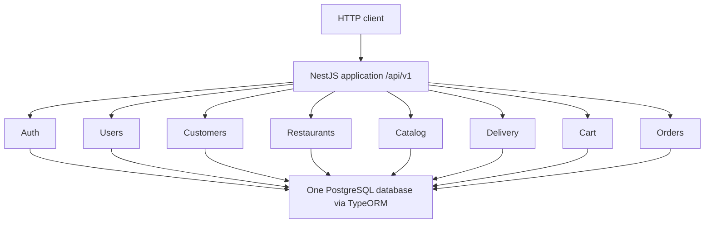

# Architecture

## Restaurant frontend

The Restaurant client is now implemented in apps/restaurant with React/Vite/TypeScript, Arabic RTL, app-local feature components and a configurable HTTP client. packages/brand shares CSS tokens and identity assets. Browser tokens stay in memory only; frontend code never imports backend internals. Admin and Delivery are implemented. See [portal design](PORTAL-DESIGN.md) and [realtime](REALTIME.md). See [design system](DESIGN-SYSTEM.md) and [Restaurant run guide](../apps/restaurant/README.md). Historical baseline sections below describe the API and monorepo preparation; this addition does not change backend architecture.

## Scope and status

One deployable NestJS application, one PostgreSQL database, and TypeORM. Features 01-14 include twenty table mappings, one history view and eight reviewed migrations. Features 01-16 are implemented, including image uploads and health checks. See [AUTH.md](AUTH.md).

The user approved the foundation and authorized Features 01-16, local tests, CI/CD and deployment preparation. Other features and actual VPS deployment still require authorization.

## Runtime structure



The diagram shows implemented business ownership. Images coordinates uploads through domain services; Health uses the shared DataSource. All modules share the same database and connection pool; no per-module databases or network calls between modules.

## Approved deployment target

Host the single NestJS backend, PostgreSQL, and primary image files on one Hostinger VPS. Run Caddy, NestJS, and PostgreSQL in separate Docker containers. Caddy is the public HTTPS entry point; PostgreSQL stays private. Persist database data, images, and Caddy state, with backup automation deferred. Dockerfile, production Compose, and Caddy templates now exist, but actual server provisioning/deployment is not performed or authorized. See [DEPLOYMENT.md](DEPLOYMENT.md).

## Code organization

```text
AKEELA/
  apps/
    api/                     # NestJS package, src/, test/, configs, Dockerfile
    restaurant/              # implemented React/Vite frontend
    admin/                   # implemented React/Vite frontend
    delivery/                # implemented React/Vite frontend
  docs/                      # shared architecture and frontend guides
  bruno/AKEELA/              # maintained API requests
  deploy/                    # Caddy and VPS/release assets
  scripts/                   # repository checks and smoke test
  .github/workflows/         # CI and owner-approved main releases
  package.json               # npm workspace root
  package-lock.json          # shared lockfile
  compose.yml
  compose.production.yml
  AGENTS.md
  AKEELA-*.md                # canonical specifications
```

As a feature is authorized, add only the files it needs:

```text
apps/api/src/modules/<feature>/
  <feature>.module.ts
  <resource>.controller.ts
  <feature>.service.ts
  dto/<action>.dto.ts
  entities/<record>.entity.ts
```

Do not create empty DTO/entity/service layers now. Add `common/` or a mail adapter only when real shared use appears. Do not create a parallel `domain/application/infrastructure` hierarchy for every simple CRUD operation.

## Responsibilities and module communication

- Controllers receive DTOs, call services, and return explicit response models. No SQL or business transitions in controllers.
- Services own use cases and enforce ownership and business rules, even when called internally.
- Inject TypeORM repositories inside their owning module; no generic repository wrappers.
- A module exports only the services or narrowly scoped types needed by another module. Do not export repositories or use another module's entity directly for queries.
- Other modules import those services through Nest module imports. `AppModule` composes modules; it never orchestrates business behavior.
- Do not add `forwardRef` to hide a circular dependency. Move the orchestration to the higher-level use case or clarify ownership.
- No event bus, queues, CQRS, microservices, or generic base services are required for this foundation.

## Transactions and concurrency

The owning use-case service opens a TypeORM transaction. When it needs another module to participate, pass the transaction `EntityManager` explicitly to that module's exported service. Every query in that use case must use repositories obtained from that manager; ordinary injected repositories do not automatically join the transaction.

Examples already required by the specifications:

- Auth orchestrates user + customer/restaurant profile creation.
- Orders orchestrates checkout across cart, catalog, addresses, and order snapshots.
- Orders orchestrates acceptance + automatic company assignment atomically; Restaurants does not call Orders to accept an order.

Cart writes lock the parent cart row. Order transitions lock/check the order row. Catalog writes lock the owning user then restaurant and recheck activation; Admin suspension locks the same profile. PostgreSQL tests cover these races. Do not hold database locks open while sending email or calling external services.

## Runtime foundation

- Express adapter, strict TypeScript, dependency injection.
- `/api/v1` prefix; CORS accepts only configured exact origins.
- Global DTO validation strips no unknown input silently: unknown fields cause rejection; no implicit type coercion.
- Environment validation fails on invalid settings without echoing credentials.
- Database startup fails when PostgreSQL is unavailable. Graceful shutdown hooks close application resources.
- Application and CLI use the same TypeORM options, with synchronization, schema dropping, SQL logging, and automatic migrations disabled.
- Feature 01 controllers return explicit success envelopes. A shared filter normalizes errors and validation failures. JWT guards check live sessions/accounts, and SMTP sends codes after commit. Public health probes exist; no Swagger document or automatic seeds exist.

Module boundaries follow [Nest module encapsulation](https://docs.nestjs.com/modules). Database changes use [TypeORM migrations](https://typeorm.io/docs/migrations/why/) rather than automatic synchronization.

Cart and checkout use SERIALIZABLE transactions with bounded retries; see [CART-ORDERS.md](CART-ORDERS.md) for lock order and the confirmed current-price checkout behavior.

Operational order controllers remain in Orders. Delivery exports company/driver validation, and Restaurants exports current activation checks. See [ORDER-DELIVERY.md](ORDER-DELIVERY.md) for state transactions and configuration.

Images uses Sharp for byte validation/re-encoding and local persistent files. It writes no foreign tables directly: exported domain setters participate in its transaction. Health exposes public process/database probes. Global HTTP serialization emits Africa/Cairo offsets while PostgreSQL keeps UTC instants. CI/CD and single-host release details are in [DEPLOYMENT.md](DEPLOYMENT.md).

## Repository and deployment boundaries

One monorepo contains the implemented API and three independently owned browser apps. Use npm workspaces with one lockfile. The API remains a modular monolith with one database. Frontends consume HTTP APIs and never import backend repositories/entities. React/Vite/TypeScript, Arabic RTL and memory-only sessions are approved for all three browser apps. See [MONOREPO.md](MONOREPO.md) for paths, environment migration, coordinated CI/release rules and Caddy sites.

## Dashboards, realtime and deployment — 2026-11-18

Admin and Delivery are implemented React/Vite/TypeScript workspaces, Arabic RTL and memory-only sessions. Their visual identities differ; shared HTTP/layout/order components live in packages/portal for these two consumers. Restaurant imports only the realtime helper and keeps its UI. Root check and consolidated CI cover all workspaces.

Socket.IO runs inside the single API process. Events invalidate authorized REST reads after order commits; no schema, microservice, Redis or durable event log is added. See [REALTIME](REALTIME.md) and [portal design](PORTAL-DESIGN.md).

The owner purchased Hostinger KVM 2 at 2.25.12.243, France. SSH confirmed Ubuntu 26.04.1 LTS. Domain: akeelaonline.tech; API/admin/vendor/delivery subdomains. Production Compose includes all services plus one-off migrations and idempotent Admin initialization. Existing Admin values are never reset. See [DEPLOYMENT](DEPLOYMENT.md).
