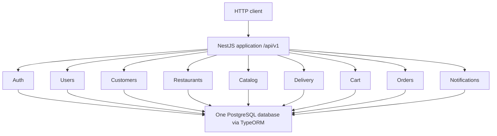

# Architecture

## Restaurant frontend

The Restaurant client is now implemented in apps/restaurant with React/Vite/TypeScript, Arabic RTL, app-local feature components and a configurable HTTP client. packages/brand shares CSS tokens and identity assets. Browser tokens survive refresh in tab-scoped sessionStorage; see AUTH.md; frontend code never imports backend internals. Admin and Delivery are implemented. See [portal design](PORTAL-DESIGN.md) and [realtime](REALTIME.md). See [design system](DESIGN-SYSTEM.md) and [Restaurant run guide](../apps/restaurant/README.md). Historical baseline sections below describe the API and monorepo preparation; this addition does not change backend architecture.

## Scope and status

One deployable NestJS application, one PostgreSQL 17 database, and TypeORM (`11` domain modules, `21` entity tables, `1` history view, and reviewed migrations). Features `01–18` are implemented, including image uploads, health checks, Socket.IO order notifications, FCM push notifications, global search, and the smart home offers feed. See [AUTH.md](AUTH.md) and [STATUS.md](STATUS.md).

## Runtime structure

When `SWAGGER_ENABLED=true`, the API serves Swagger at `/api/v1/docs` and OpenAPI JSON at `/api/v1/docs-json`. Production defaults to false; disabling it removes documentation routes/assets without affecting business APIs. `apps/api/src/documentation` owns presentation-only metadata; controllers/validated DTOs supply the route/input structure. No new business module, entity, database access or separate service. See [SWAGGER.md](SWAGGER.md).

The UI uses four role references (Customer, Restaurant, Admin, Delivery Company), each with client-specific feature groups and direct `/api/v1/docs/<role>` pages. Shared authentication is repeated where needed; full JSON stays compatible. Role projections filter documentation only, never business access policies.



The diagram shows implemented business ownership. Images coordinates uploads through domain services; Health uses the shared DataSource. All modules share the same database and connection pool; no per-module databases or network calls between modules.

## Deployment topology

The NestJS backend, PostgreSQL 17, three static Nginx frontends (`admin`, `restaurant`, `delivery`), and Caddy run in separate Docker containers on one Hostinger KVM 2 VPS (`2.25.12.243`). Caddy is the public HTTPS entry point for `*.akeelaonline.tech`; PostgreSQL stays on an internal Docker network. Persistent named volumes hold database data, images, and Caddy state; off-server backup automation remains deferred. See [DEPLOYMENT.md](DEPLOYMENT.md).

## Code organization

```text
AKEELA/
  apps/
    api/                     # NestJS package, src/, test/, configs, Dockerfile
    restaurant/              # React/Vite Restaurant dashboard
    admin/                   # React/Vite Admin dashboard
    delivery/                # React/Vite Delivery Company dashboard
  packages/
    brand/                   # shared CSS tokens, forms/sidebar styles, brand assets
    portal/                  # shared HTTP/session/realtime/dialog/portal helpers
  docs/                      # architecture, API, and frontend guides
  bruno/AKEELA/              # maintained API collection
  deploy/                    # Caddy and VPS/release assets
  scripts/                   # repository checks, setup, and smoke tests
  .github/workflows/         # CI, owner-approved releases, and uptime monitor
  package.json               # npm workspace root
  package-lock.json          # shared lockfile
  compose.yml
  compose.production.yml
  AGENTS.md
  AKEELA-*.md                # canonical specifications
```

As a feature is authorized, add only the files it needs:

```text
apps/api/src/modules/<feature>/
  <feature>.module.ts
  <resource>.controller.ts
  <feature>.service.ts
  dto/<action>.dto.ts
  entities/<record>.entity.ts
```

Do not create empty DTO/entity/service layers now. Add `common/` or a mail adapter only when real shared use appears. Do not create a parallel `domain/application/infrastructure` hierarchy for every simple CRUD operation.

## Responsibilities and module communication

- Controllers receive DTOs, call services, and return explicit response models. No SQL or business transitions in controllers.
- Services own use cases and enforce ownership and business rules, even when called internally.
- Inject TypeORM repositories inside their owning module; no generic repository wrappers.
- A module exports only the services or narrowly scoped types needed by another module. Do not export repositories or use another module's entity directly for queries.
- Other modules import those services through Nest module imports. `AppModule` composes modules; it never orchestrates business behavior.
- Do not add `forwardRef` to hide a circular dependency. Move the orchestration to the higher-level use case or clarify ownership.
- No event bus, queues, CQRS, microservices, or generic base services are required for this foundation.

## Transactions and concurrency

The owning use-case service opens a TypeORM transaction. When it needs another module to participate, pass the transaction `EntityManager` explicitly to that module's exported service. Every query in that use case must use repositories obtained from that manager; ordinary injected repositories do not automatically join the transaction.

Examples already required by the specifications:

- Auth orchestrates user + customer/restaurant profile creation.
- Orders orchestrates checkout across cart, catalog, addresses, and order snapshots.
- Orders orchestrates acceptance + automatic company assignment atomically; Restaurants does not call Orders to accept an order.

Cart writes lock the parent cart row. Order transitions lock/check the order row. Catalog writes lock the owning user then restaurant and recheck activation; Admin suspension locks the same profile. PostgreSQL tests cover these races. Do not hold database locks open while sending email or calling external services.

## Runtime foundation

- Express adapter, strict TypeScript, dependency injection.
- `/api/v1` prefix; CORS accepts only configured exact origins.
- Global DTO validation strips no unknown input silently: unknown fields cause rejection; no implicit type coercion.
- Environment validation fails on invalid settings without echoing credentials.
- Database startup fails when PostgreSQL is unavailable. Graceful shutdown hooks close application resources.
- Application and CLI use the same TypeORM options, with synchronization, schema dropping, SQL logging, and automatic migrations disabled.
- Controllers return explicit success envelopes; a shared filter normalizes errors and validation failures. JWT guards check live sessions/accounts, and SMTP sends OTP codes after commit. Public health probes and optional Swagger docs (`SWAGGER_ENABLED`) exist; no automatic business seeds exist.

Module boundaries follow [Nest module encapsulation](https://docs.nestjs.com/modules). Database changes use [TypeORM migrations](https://typeorm.io/docs/migrations/why/) rather than automatic synchronization.

Cart and checkout use SERIALIZABLE transactions with bounded retries; see [CART-ORDERS.md](CART-ORDERS.md) for lock order and the confirmed current-price checkout behavior.

Operational order controllers remain in Orders. Delivery exports company/driver validation, and Restaurants exports current activation checks. See [ORDER-DELIVERY.md](ORDER-DELIVERY.md) for state transactions and configuration.

Images uses Sharp for byte validation/re-encoding and local persistent files. It writes no foreign tables directly: exported domain setters participate in its transaction. Health exposes public process/database probes. Global HTTP serialization emits Africa/Cairo offsets while PostgreSQL keeps UTC instants. CI/CD and single-host release details are in [DEPLOYMENT.md](DEPLOYMENT.md).

## Repository and deployment boundaries

One monorepo contains the implemented API, three independently owned React/Vite/TypeScript Arabic RTL dashboards, and shared `packages/brand` + `packages/portal` workspaces under one root lockfile. Frontends consume HTTP APIs and Socket.IO (`/orders`), never backend repositories/entities. See [MONOREPO.md](MONOREPO.md), [REALTIME.md](REALTIME.md), [PORTAL-DESIGN.md](PORTAL-DESIGN.md), and [DEPLOYMENT.md](DEPLOYMENT.md).
