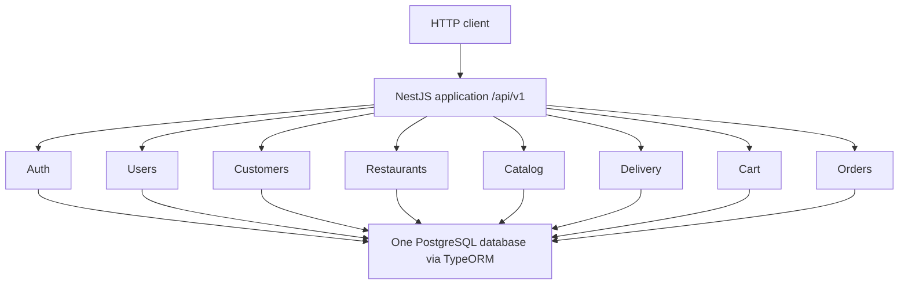

# Architecture

## Scope and status

One deployable NestJS application, one PostgreSQL database, and TypeORM. The current code is a composition/configuration scaffold. Feature modules are empty and expose no routes or providers. No schema objects or business behavior have been generated.

The user must review and approve the foundation before business implementation begins.

## Runtime structure



The diagram shows planned ownership, not implemented persistence. All modules share the same database and connection pool; no per-module databases or network calls between modules.

## Approved deployment target

Host the single NestJS backend, PostgreSQL, and primary image files on one Hostinger VPS. Run Caddy, NestJS, and PostgreSQL in separate Docker containers. Caddy provides the public HTTPS entry point and routes API requests to the backend; PostgreSQL stays on the private Docker network. Persist database data, images, and Caddy certificate state, with backups outside the VPS. See [DEPLOYMENT.md](DEPLOYMENT.md) for boundaries and remaining inputs. This target is approved, but production configuration and deployment are not implemented or authorized by this documentation change.

## Code organization

```text
src/
  main.ts                    # starts the application
  bootstrap.ts               # shared HTTP setup
  app.module.ts              # composition root only
  config/environment.ts      # parse and validate settings
  database/
    database.module.ts       # Nest TypeORM connection
    database.options.ts      # shared application/CLI options
    data-source.ts           # CLI DataSource; not a second runtime connection
    migrations/              # empty until schema work is authorized
  modules/
    auth/ users/ customers/ restaurants/
    catalog/ delivery/ cart/ orders/
test/                        # foundation tests; later integration/e2e tests
```

As a feature is authorized, add only the files it needs:

```text
modules/<feature>/
  <feature>.module.ts
  <resource>.controller.ts
  <feature>.service.ts
  dto/<action>.dto.ts
  entities/<record>.entity.ts
```

Do not create empty DTO/entity/service layers now. Add `common/` or a mail adapter only when real shared use appears. Do not create a parallel `domain/application/infrastructure` hierarchy for every simple CRUD operation.

## Responsibilities and module communication

- Controllers receive DTOs, call services, and return explicit response models. No SQL or business transitions in controllers.
- Services own use cases and enforce ownership and business rules, even when called internally.
- Inject TypeORM repositories inside their owning module; no generic repository wrappers.
- A module exports only the services or narrowly scoped types needed by another module. Do not export repositories or use another module's entity directly for queries.
- Other modules import those services through Nest module imports. `AppModule` composes modules; it never orchestrates business behavior.
- Do not add `forwardRef` to hide a circular dependency. Move the orchestration to the higher-level use case or clarify ownership.
- No event bus, queues, CQRS, microservices, or generic base services are required for this foundation.

## Transactions and concurrency — future implementation

The owning use-case service opens a TypeORM transaction. When it needs another module to participate, pass the transaction `EntityManager` explicitly to that module's exported service. Every query in that use case must use repositories obtained from that manager; ordinary injected repositories do not automatically join the transaction.

Examples already required by the specifications:

- Auth orchestrates user + customer/restaurant profile creation.
- Orders orchestrates checkout across cart, catalog, addresses, and order snapshots.
- Orders orchestrates acceptance + automatic company assignment atomically; Restaurants does not call Orders to accept an order.

Cart writes lock the parent cart row. Order transitions lock/check the order row. Lock order and idempotency behavior must be specified and tested with PostgreSQL when these features are built. Do not hold database locks open while sending email or calling external services.

## Runtime foundation

- Express adapter, strict TypeScript, dependency injection.
- `/api/v1` prefix; CORS accepts only configured exact origins.
- Global DTO validation strips no unknown input silently: unknown fields cause rejection; no implicit type coercion.
- Environment validation fails on invalid settings without echoing credentials.
- Database startup fails when PostgreSQL is unavailable. Graceful shutdown hooks close application resources.
- Application and CLI use the same TypeORM options, with synchronization, schema dropping, SQL logging, and automatic migrations disabled.
- No controllers, success-envelope interceptor, business exception mapping, JWT guards, health endpoint, SMTP client, Swagger document, or seeds exist yet. Add the HTTP response adapter with the first authorized API feature so responses follow the existing contract.

Module boundaries follow [Nest module encapsulation](https://docs.nestjs.com/modules). Database changes use [TypeORM migrations](https://typeorm.io/docs/migrations/why/) rather than automatic synchronization.
